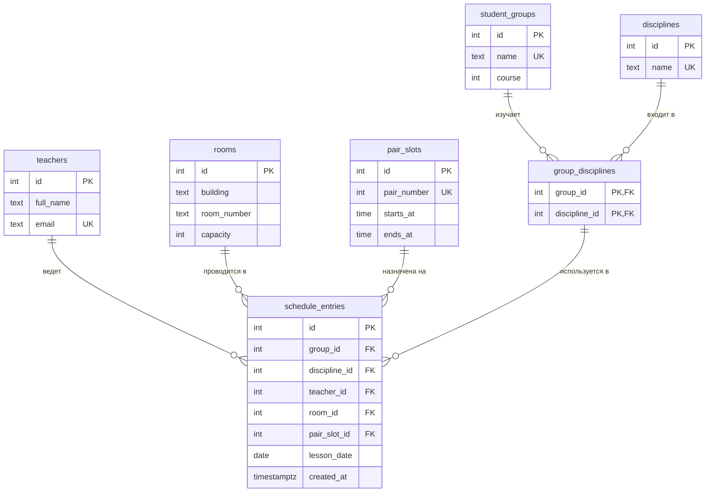

# Расписание вуза

Тема № 8: **Расписание вуза**.

База данных хранит сведения о преподавателях, учебных группах, аудиториях, дисциплинах и расписании занятий и предназначена для формирования и контроля учебного расписания вуза.

| | |
| --- | --- |
| Главная таблица | `schedule_entries` |
| Связь N:M | `student_groups` и `disciplines` через `group_disciplines` |
| Бизнес-правило | Аудитория не может быть занята двумя занятиями в одно и то же время |
| СУБД | PostgreSQL 17 в Docker |

## Задания курса

Правила курса, установка и порядок сдачи: [docs/README.md](docs/README.md).

| Лаба | Задание |
| --- | --- |
| 1. Модель данных и схема | [docs/lab-1.md](docs/lab-1.md) |
| 2. Запросы | [docs/lab-2.md](docs/lab-2.md) |
| 3. Логика в базе | [docs/lab-3.md](docs/lab-3.md) |
| 4. Транзакции и доступ | [docs/lab-4.md](docs/lab-4.md) |
| 5. Производительность | [docs/lab-5.md](docs/lab-5.md) |
| Витрина к защите | [docs/showcase.md](docs/showcase.md) |

## Как запустить

```bash
cp .env.example .env
docker compose up -d
dbcheck run demo/lab1.sql
dbcheck run demo/lab2.sql --sql
```

Работа с базой:

```bash
docker compose exec db psql -U postgres -d app
```

Сценарий лабораторной работы №1 можно выполнить в `psql` командой:

```text
\i /demo/lab1.sql
```
Сценарий лабораторной работы №2 выполняется командой dbcheck run demo/lab2.sql --sql. Проверка дополнительных заданий: dbcheck --lab 2 --stars.

После изменения скриптов в папке `db/` базу необходимо пересоздать:

```bash
docker compose down -v
docker compose up -d
```

## ER-диаграмма



## Ограничения

| Ограничение | Таблица и колонки | Зачем |
| --- | --- | --- |
| `UNIQUE` | `teachers.email` | Email преподавателя не должен повторяться |
| `UNIQUE` | `student_groups.name` | Название учебной группы должно быть уникальным |
| `UNIQUE` | `rooms(building, room_number)` | Одна аудитория не должна повторяться |
| `UNIQUE` | `disciplines.name` | Название дисциплины не должно повторяться |
| `UNIQUE` | `schedule_entries(lesson_date, pair_slot_id, room_id)` | Аудитория не может быть занята двумя занятиями одновременно |
| `UNIQUE` | `schedule_entries(lesson_date, pair_slot_id, group_id)` | У группы не может быть двух занятий одновременно |
| `CHECK` | `student_groups.course` | Курс должен быть от 1 до 6 |
| `CHECK` | `rooms.capacity` | Вместимость аудитории должна быть больше 0 |
| `CHECK` | `pair_slots.pair_number` | Номер пары должен быть от 1 до 10 |
| `CHECK` | `pair_slots.starts_at, pair_slots.ends_at` | Время окончания пары должно быть позже времени начала |

## Нормализация

Изначально данные расписания можно представить одной таблицей:

| Группа | Курс | Дисциплина | Преподаватель | Email | Аудитория | Корпус | Номер пары | Начало | Конец | Дата |
| --- | --- | --- | --- | --- | --- | --- | --- | --- | --- | --- |

В такой таблице сведения о группах, преподавателях, дисциплинах и аудиториях повторяются для каждой пары.

### 1НФ

Все значения хранятся отдельно, в одной ячейке находится одно значение.

### 2НФ

Данные, которые относятся к отдельным сущностям, вынесены в собственные таблицы: `teachers`, `student_groups`, `rooms`, `disciplines` и `pair_slots`.

Связь между группами и дисциплинами вынесена в отдельную таблицу `group_disciplines`.

### 3НФ

В таблицах отсутствуют зависимости между неключевыми полями. Информация о каждой сущности хранится в одном месте, а таблица `schedule_entries` содержит ссылки на связанные данные.

## Типы данных

| Данные | Тип | Причина |
| --- | --- | --- |
| Идентификаторы | `integer` | Используются как первичные и внешние ключи |
| Названия и ФИО | `text` | Строковые данные переменной длины |
| Курс | `integer` | Целое числовое значение |
| Вместимость аудитории | `integer` | Количество мест задаётся целым числом |
| Время начала и окончания пары | `time` | Хранится только время суток |
| Дата занятия | `date` | Для расписания требуется календарная дата |
| Время создания записи | `timestamptz` | Хранит дату и время создания записи с учётом часового пояса |

## Что происходит при удалении

| Связь | ON DELETE | Причина |
| --- | --- | --- |
| `group_disciplines → student_groups` | `CASCADE` | При удалении группы её связи с дисциплинами больше не нужны |
| `group_disciplines → disciplines` | `CASCADE` | При удалении дисциплины её связи с группами больше не нужны |
| `schedule_entries → group_disciplines` | `RESTRICT` | Нельзя удалить используемую в расписании связь |
| `schedule_entries → teachers` | `RESTRICT` | Нельзя удалить преподавателя, который указан в расписании |
| `schedule_entries → rooms` | `RESTRICT` | Нельзя удалить аудиторию, которая используется в расписании |
| `schedule_entries → pair_slots` | `RESTRICT` | Нельзя удалить время пары, которое используется в расписании |

Для задания ★★ файл `db/03_generate.sql` создаёт 1000 дополнительных записей расписания с помощью `generate_series`.

## Что сделано по лабам

| Лаба | Что сделано | Сценарий |
| --- | --- | --- |
| 1 | Создана модель данных, таблицы, ключи, ограничения и тестовые данные | `demo/lab1.sql` |
| 2 | 15 SQL-запросов: JOIN, группировки, подзапросы, INSERT, UPDATE, DELETE, CTE, оконные функции и аналитика | `demo/lab2.sql` || 3 | — | `demo/lab3.sql` |
| 4 | — | `demo/lab4.sql`, `demo/race.sql`, `demo/race_fixed.sql` |
| 5 | — | `demo/lab5.sql` |